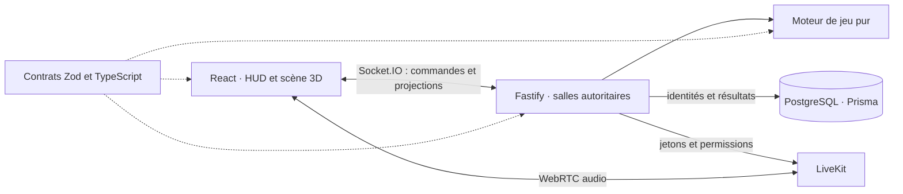
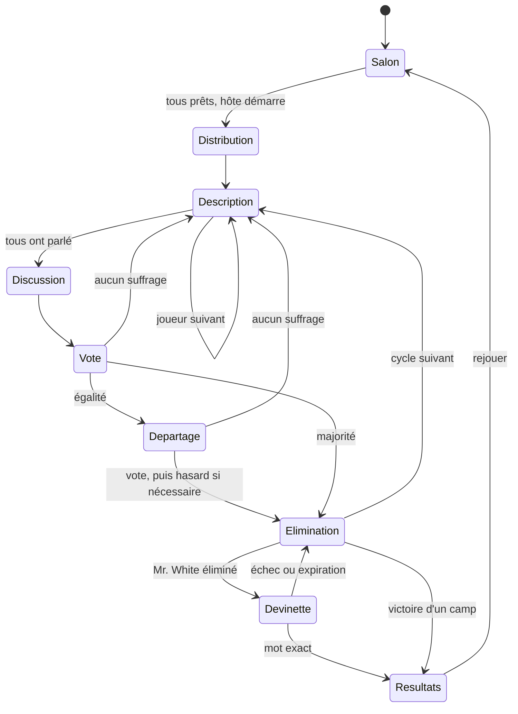

# Architecture de RENÉ

## Incréments

1. Contrats partagés et moteur déterministe, puis transports et première partie complète.
2. Reconnexion et scores fiables, puis salon 3D et personnalisation.
3. Vocal, mise en scène, tests navigateur et conditionnement Docker.

Le moteur ne dépend ni du réseau, ni de React, ni de la base. Le hasard et le temps sont injectables pour tester les transitions. Le serveur utilise le hasard cryptographique de Node pour les parties réelles.

## Composants

Les avatars sont des géométries originales modulaires aux couleurs de `style.md` : poire, rectangle et haricot, visages et accessoires assemblés. Aucune génération d'image ou de personnage externe n'est requise à l'exécution. Le décor et les animations servent les phases ; les contrôles critiques restent en 2D.

## États et règles

La représentation réseau nomme les phases `reveal`, `description`, `discussion`, `vote`, `tiebreak`, `elimination`, `whiteGuess`, `results`. L'élimination d'un Mr. White ouvre directement sa tentative avant le contrôle de victoire habituel. Distribution : 8 secondes ; scène d'élimination : 3 secondes. Les autres durées sont configurables, avec 45/120/30/30 secondes par défaut pour description/discussion/vote/devinette.

Les mots et les rôles restent identiques pendant toute une partie. Un nouveau cycle de description n'est pas une nouvelle partie. Une session rassemble plusieurs parties et leur classement cumulé. Une absence laisse courir les échéances ; un départ volontaire est un abandon sans tentative spéciale. Les Civils gagnent dès qu'aucun Infiltré n'est vivant ; sinon les Infiltrés gagnent lorsqu'il reste au plus un Civil. Les points récompensent tous les membres du camp gagnant, même éliminés ; une devinette réussie récompense seulement son auteur.

## Protocole et confidentialité

Les événements sont définis dans `packages/contracts`. Le client émet `command` avec identifiant de commande et, pour les actions de jeu, identifiant de phase. L'accusé retourne un succès ou un message d'erreur. Les actions doublonnées ou concernant une ancienne phase ne doivent pas être exécutées à nouveau. Les mutations d'une salle et ses échéances sont sérialisées.

Le serveur publie une `RoomSnapshot` explicite et un `PrivatePlayerState` par joueur. La projection privée contient son mot ou `null`, jamais son rôle Civil/Undercover. La projection publique révèle le rôle d'un éliminé et ne contient les deux mots et tous les rôles qu'aux résultats. La banque de mots est importée exclusivement par le serveur. Les mouvements transmettent une direction bornée ; le serveur calcule la position, limite la vitesse et applique les collisions du salon.

La connexion utilise une identité invitée par cookie HttpOnly. PostgreSQL conserve le **hash** du jeton et l'apparence, sans stocker le jeton brut. Un rafraîchissement récupère une projection fraîche. Deux onglets partageant un cookie ne constituent pas deux joueurs. L'hôte est transféré au participant connecté le plus ancien après 30 secondes d'absence, immédiatement s'il quitte explicitement.

Les descriptions et messages sont bornés et rendus comme texte React. Les commandes sont validées avec Zod côté serveur ; identité, disponibilité, phase, droits d'hôte et éligibilité au vote sont vérifiés indépendamment de l'interface.

## Persistance et audio

`Persistence` expose `getGuest`, `saveGuest`, `recordResult` et `close`. L'adaptateur PostgreSQL enregistre une ligne immuable par ID de partie (`ON CONFLICT DO NOTHING`) : les répétitions n'ajoutent pas deux scores. Le JSON du résultat constitue le registre des points ; aucune table de total dénormalisé n'est nécessaire. Les sessions en mémoire sont identifiées par UUID afin que la réutilisation d'un code de salle ne mélange pas l'historique.

Une sauvegarde de résultat indisponible reste en attente et est retentée avec un délai, sans bloquer le chat ou le départ de la salle. La partie suivante attend l'enregistrement pour préserver l'attribution unique des points. Les identités des participants partis sont conservées pour les résultats ; un retour dans la même session retrouve son score.

Les salles actives utilisent `RoomStore`, implémenté en mémoire. La V1 est mono-instance ; ajouter Redis et une reprise durable exigera de coordonner les commandes, échéances, sockets et transitions, pas seulement de remplacer une Map.

Les jetons LiveKit n'autorisent que l'audio et sont liés au joueur et à la génération du salon vocal. À une réduction de droits, les clients migrent vers une nouvelle génération ; un ancien jeton ne permet donc pas de rejoindre le salon actif avec les anciens droits. Les éliminés et les arrivants en attente écoutent, sauf si l'hôte autorise leur parole. Le chat suit les mêmes permissions. LiveKit auto-hébergé ne fournit pas la révocation immédiate des jetons de LiveKit Cloud : [comparaison officielle](https://docs.livekit.io/transport/self-hosting/).
