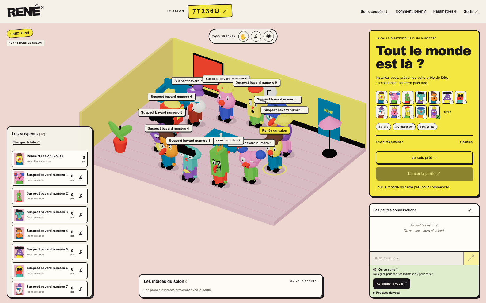
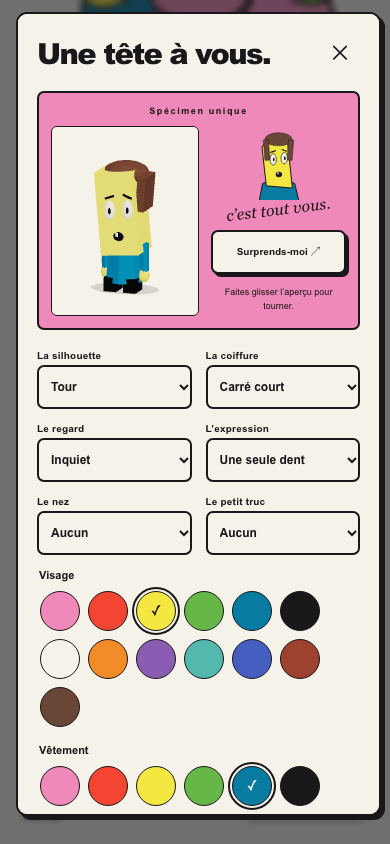
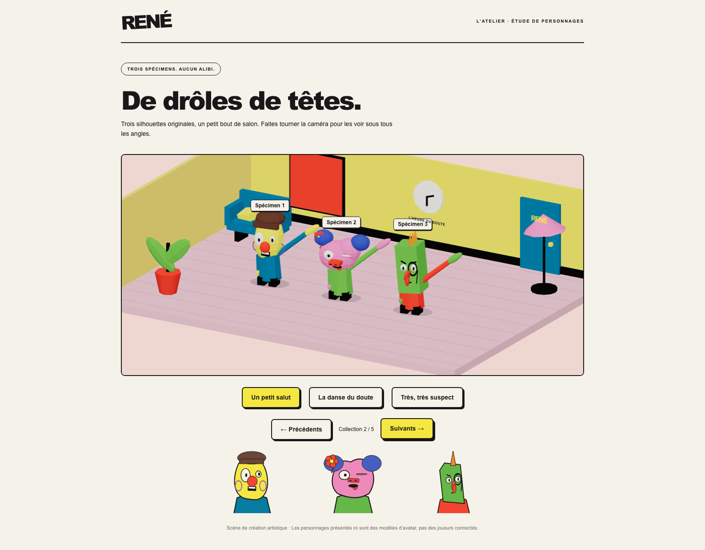
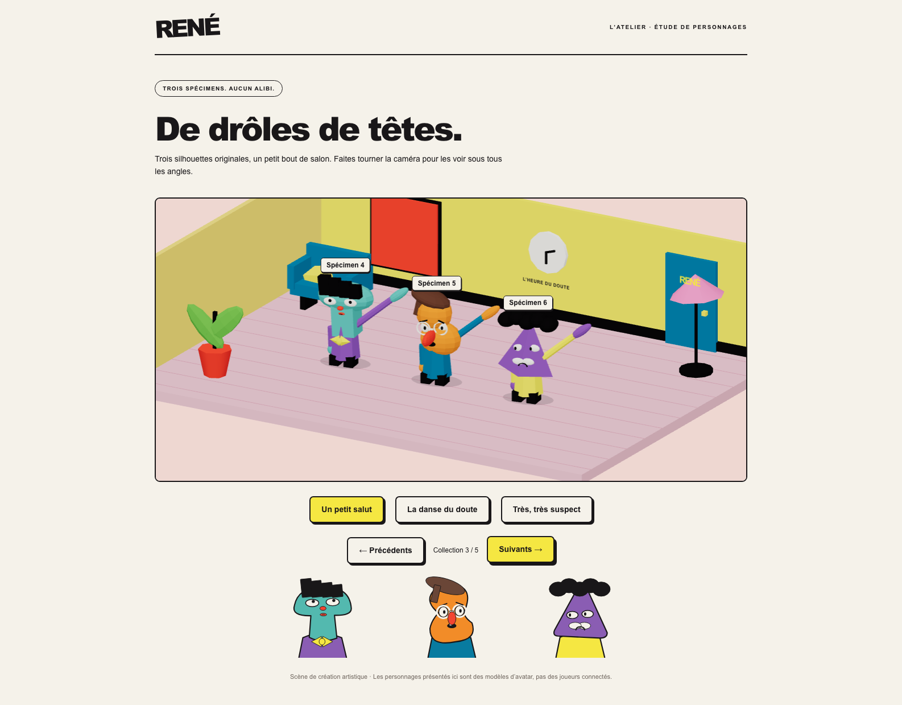
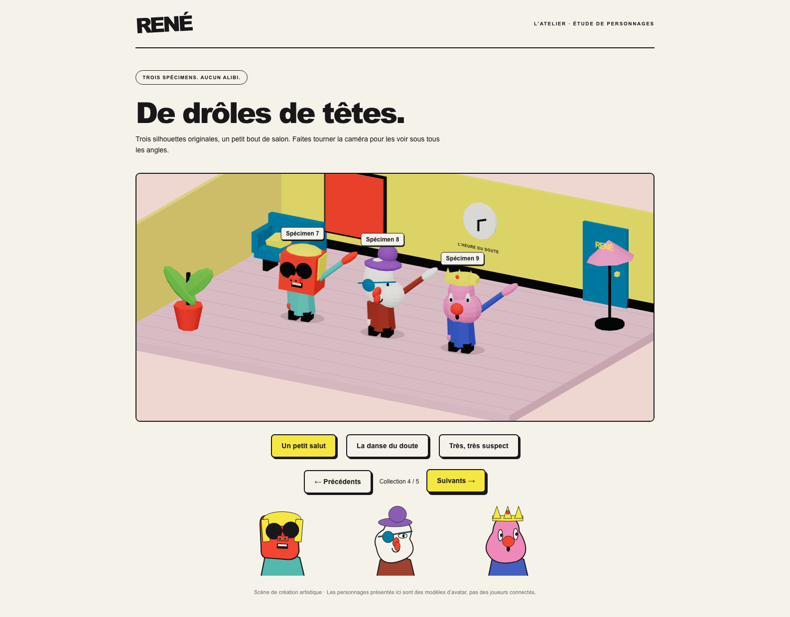
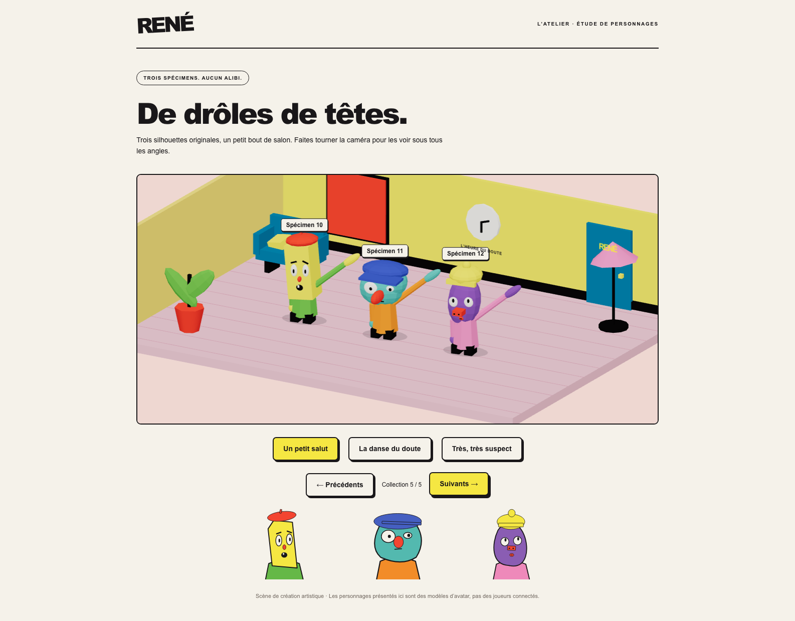

# Extension de personnalisation des avatars

## Base et périmètre

Branche `feature/avatar-customization-expansion`, créée depuis `origin/main` à jour (`89ddf90`). La copie de travail était propre et la branche n'existait ni localement ni sur le remote. Aucun développement sur `main`, aucune fusion ni aucun déploiement.

L'audit a porté sur les contrats, `Avatar.tsx`, `AvatarPortrait.tsx`, l'éditeur, le stockage local, les adaptateurs de profils et les commandes Socket.IO. Les options étaient dispersées entre trois composants ; il n'existait ni tirage d'apparence ni aperçu 3D dans l'éditeur. Les géométries simples, la marionnette animée, les chemins de tête SVG et la sauvegarde JSON existante ont été réutilisés.

## Catalogue

| Catégorie | Avant | Après |
| --- | ---: | ---: |
| Têtes | 3 | 9 |
| Coiffures | 3 + aucune | 11 + aucune |
| Regards | 3 | 9 |
| Bouches | 3 | 9 |
| Nez | 3 | 5 + aucun |
| Accessoires | 3 + aucun | 13 + aucun |
| Couleurs par palette | 7 | 13 |

Toutes les valeurs antérieures sont conservées. Les six couleurs de référence et le crème restent disponibles ; six couleurs franches supplémentaires complètent les palettes visage, vêtement, cheveux et accessoires. Les accessoires disposent désormais de leur propre couleur.

Le style reste fondé sur les volumes simples, les proportions absurdes, l'asymétrie, les visages minimaux et les matériaux Lambert sans textures réalistes. Les trois anciennes silhouettes sont conservées. Les nouvelles formes changent la silhouette, les coiffures leur contour et les expressions la forme ou la position des traits.

## Architecture et compatibilité

- `packages/contracts/src/appearance.ts` contient le catalogue typé, ses libellés, les palettes, la validation et `randomAppearance`. Le module public conserve ses exports antérieurs.
- `apps/web/src/avatar/catalog.ts` décrit les silhouettes et pièces visuelles. `model.ts` compose la même recette pour les meshes et les portraits SVG ; les contours de tête SVG restent dessinés à la main.
- `PartMeshes.tsx` partage huit géométries entre les avatars et réutilise les matériaux de la palette. `Avatar.tsx` conserve les pivots et le code des animations. Aucune construction de géométrie ou de matériau n'a été ajoutée dans `useFrame`.
- Le nouveau champ `accessoryColor` est facultatif en entrée et complété à la lecture. Un ancien chapeau reste vert ; les autres anciens accessoires gardent l'encre. Les autres valeurs du profil sont conservées. La même normalisation s'applique au stockage en mémoire, à PostgreSQL et au profil local.
- Les apparences restent validées côté serveur et transportées dans les commandes et snapshots existants. Aucun événement, table ou migration n'est ajouté. Un ancien profil est accepté ; un ancien client ne sait naturellement pas afficher des variantes introduites après sa version et doit être rechargé pour les utiliser.

Les yeux, pupilles, nez et accessoires faciaux prennent appui sur la surface des volumes. Les montures s'adaptent à la taille des yeux, les boucles aux côtés des têtes, et les franges restent au-dessus des yeux. Les coiffures sont comprimées sous un couvre-chef ; les choix manuels restent conservés. Le tirage aléatoire privilégie l'absence de cheveux sous un chapeau et des couleurs de visage/vêtement différentes.

Les yeux rouges d'élimination sont rendus en SVG et en 3D, y compris avec lunettes de soleil ou cache-œil. La taille, la pose d'élimination, la victoire, la marche et les emotes `wave`, `suspect`, `dance` conservent leur fonctionnement.

## Éditeur et atelier

L'éditeur garde sa modale et ses catégories, ajoute l'aperçu 3D chargé à la demande, un portrait associé, quatre palettes et « Surprends-moi ». Les changements mettent à jour le même Canvas. Son zoom et son centrage s'adaptent à la hauteur du personnage et aux dimensions R3F, sans mesure DOM par image ; une tête haute avec chapeau reste cadrée sur mobile. L'aperçu peut tourner au glisser ; le portrait reste disponible sans WebGL. Les contrôles ont des libellés accessibles et les couleurs sélectionnées un état `aria-pressed`.

Sur mobile, l'aperçu et le portrait occupent le haut de la modale, les catégories deux colonnes et les couleurs plusieurs lignes. La modale défile verticalement. Les commandes de déplacement restent bloquées pendant la personnalisation par le mécanisme existant.

L'atelier existant `/?art=1` conserve ses trois modèles et propose quatre trios supplémentaires, avec portraits associés et commandes d'emotes. Ces modèles sont explicitement illustratifs. La recette du salon utilise bien douze identités connectées au serveur, dont onze clients Socket.IO indépendants.

## Validation

Recette des 16 et 19 octobre 2026 :

- `npm run check` : TypeScript, ESLint, **179 tests dans 16 fichiers**, builds frontend et serveur réussis.
- Contrats : chaque option et couleur, champs inconnus refusés, profil ancien et valeurs par défaut, 2 000 apparences aléatoires valides et sérialisables.
- Rendu : distinction des recettes, **1 512 combinaisons tête/coiffure/accessoire** avec géométrie finie et bornée, points d'attache, portraits et yeux rouges sans mutation du profil.
- Persistance et réseau : aller-retour de profil dans l'adaptateur en mémoire, diffusion à quatre vrais clients Socket.IO, sauvegarde, actualisation de session et reconnexion. La lecture/écriture JSON PostgreSQL existante utilise le même schéma, sans modification de l'adaptateur SQL ni migration ; aucun aller-retour sur une base de production n'est réalisé.
- `RENE_VOICE_E2E=1 npm run test:e2e` : **16 scénarios réussis en 7,5 minutes**, sans scénario ignoré. La suite couvre l'éditeur desktop/mobile, le même Canvas pendant l'édition, la diffusion aux autres navigateurs, la sauvegarde/reconnexion, la partie complète, les réactions, les trois emotes, l'élimination, le lobby à douze, cinq tailles d'écran et les scénarios LiveKit existants.
- Après l'ajustement final de la caméra d'aperçu : `npm run check` de nouveau réussi et les trois scénarios avatar rejoués avec succès. Le cas mobile tête haute/chapeau contrôle les limites projetées de la géométrie dans la caméra.
- Salon à douze participants : **307 meshes, 307 appels de rendu et 34 336 triangles** observés pour la scène complète, décor compris. Le seuil du scénario est de 650 appels. Huit géométries de pièces/membres et les matériaux de la palette sont mutualisés entre avatars ; le décor conserve ses propres ressources.

Les captures de l'éditeur et de l'atelier ont été inspectées. Cette inspection a conduit à relever les franges sur les visages hauts et à avancer les pupilles sur les volumes anguleux. Les images ci-dessous sont issues de la suite complète après ces corrections.

## Captures

Les images montrent uniquement les avatars, l'éditeur ou le lobby.

### Salon desktop à douze participants — 1 586 × 992

### Éditeur mobile — 390 × 844

[Salon mobile](images/avatar-customization/avatar-hub-mobile.png) · [Éditeur desktop](images/avatar-customization/avatar-editor-desktop.png) · [Tête haute avec chapeau sur mobile](images/avatar-customization/avatar-mobile-tall-hat.png)

### Collections — géométries 3D et portraits associés

## Limites

La recette mobile utilise Chromium avec un viewport tactile ; les appareils physiques et leurs GPU ne sont pas couverts. Le budget de pièces et les appels de rendu sont contrôlés, sans annoncer de fréquence d'image universelle.

La recette visuelle couvre les modèles contrastés de l'atelier et un salon de douze apparences. Elle ne constitue pas une inspection humaine exhaustive de toutes les combinaisons possibles. Les couvre-chefs cachent naturellement une partie des cheveux et les lunettes de soleil une partie du regard.

Avec douze pseudonymes longs, certaines étiquettes 3D se chevauchent encore ; la liste et les portraits du HUD restent lisibles. La capture du salon conserve volontairement ce cas de charge.

Aucune dépendance ajoutée. Caddy, Docker, LiveKit et la configuration du port HTTP 8080 ne sont pas modifiés.
