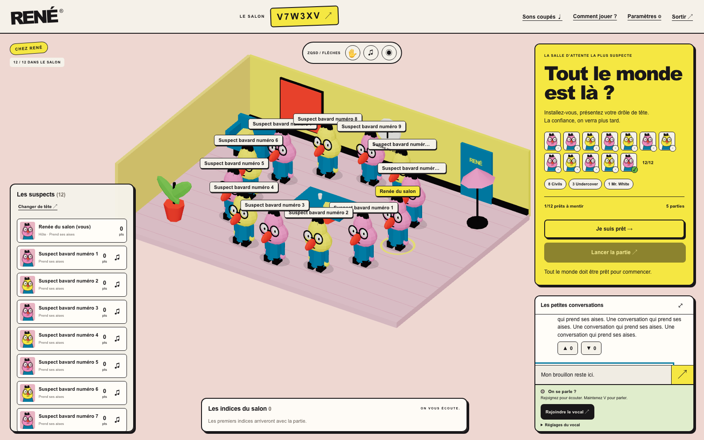
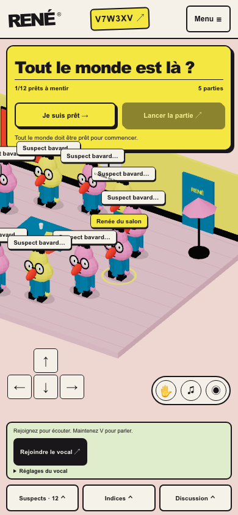

# RENÉ V1.3 — Le hub comme scène principale

## Portée et décisions

Branche `feature/v1.3-ui-refactor`, créée depuis `origin/main` après la fusion V1.2 (`0732710`). La refonte porte sur le frontend. Les contrats, événements, règles, dépendances et services restent ceux de V1.2.

- `RoomView` assemble une scène plein écran, une navigation et une grille de panneaux qui laisse passer les pointeurs vers la scène. Seuls les contrôles et panneaux visibles les interceptent.
- `RoomNavigation` et `Suspects` conservent invitation, aide, effets sonores, permissions, personnalisation, scores et mute local. Sur mobile, le menu offre des commandes plus larges.
- `Gameplay` contient les actions de la phase, le mot privé et un en-tête qui reste visible pendant le défilement. Le lobby montre les participants réels et la capacité de 12 places.
- `DescriptionHistory` est autonome. Les cartes proviennent des descriptions publiques et de l'ordre serveur. Les indices attendus ne sont pas des contributions ; les expirations sont identifiées. Les tours antérieurs se déplient du plus récent au plus ancien.
- `Communication` conserve une seule instance de `Chat` et de `Voice`. Le chat s'agrandit dans son emplacement, se referme avec Échap et restitue le focus. Le vocal reste monté et accessible lorsque le tiroir est fermé. Les réglages secondaires s'ouvrent au-dessus du pied de panneau.
- Les messages utilisent le nom enregistré, l'heure et le portrait du participant présent. Un auteur retiré du salon reçoit un portrait neutre.

## Écrans et cadrage

| Format | Composition |
| --- | --- |
| ≥ 1 200 px et ≥ 700 px | Suspects à gauche (280 px), indices en bas au centre (jusqu'à 600 px), gameplay et communication à droite (360 px). Les deux panneaux droits partagent la hauteur disponible. |
| Intermédiaire | Gameplay et communication visibles ; un panneau auxiliaire Suspects ou Indices se déplie à gauche. |
| < 900 px ou < 600 px de haut | Tiroir inférieur unique Suspects / Indices / Discussion, fermé à l'arrivée. Action essentielle et barre vocale restent accessibles. Le paysage court utilise deux colonnes. |

La hauteur de secours est `100dvh`. `visualViewport` ajuste la fenêtre réellement visible et son décalage ; les marges tiennent compte des zones de sécurité. Les longues listes défilent dans leurs panneaux.

Un `ResizeObserver` mesure les panneaux lors des changements de géométrie. `findClearArea` recherche un rectangle dégagé pour la caméra. Le Canvas conserve son identité ; la caméra orthographique garde son angle et adapte zoom/décalage. Sur mobile, elle suit le joueur local ou actif hors vote et privilégie la table pendant le vote. Les transitions sont amorties, immédiates si les mouvements réduits sont demandés. Le DPR reste plafonné à 1,5. Aucune mesure DOM ne s'exécute dans la boucle de rendu.

## Validation automatisée

Recette exécutée le 16 octobre 2026, avec Node 25.8.0, Chromium Playwright et le service Docker LiveKit local.

| Commande | Résultat |
| --- | --- |
| `npm ci --cache /private/tmp/rene-npm-cache` | Installation réussie, verrou inchangé. |
| `npm run db:generate` | Client Prisma généré. |
| `npm run check` | TypeScript, ESLint, 171 tests unitaires/intégration et builds web/serveur réussis. |
| `RENE_VOICE_E2E=1 npm run test:e2e` | 13 scénarios Chromium réussis en 5,8 minutes ; aucun scénario ignoré. |

Les scénarios ajoutés vérifient les limites des panneaux et du Canvas à cinq tailles, douze identités connectées au vrai serveur (un navigateur et onze clients Socket.IO authentifiés), les longs messages et pseudonymes, la continuité du brouillon/Canvas, les auteurs retirés et la reconnexion. Le salon de douze participants poursuit jusqu'aux douze descriptions et au vote parmi onze candidats ; le dernier candidat peut être sélectionné après défilement. Le chat agrandi doit dépasser les dimensions du panneau initial. Le centre de la scène reste une cible du Canvas. La mise à l'échelle du viewport, les mouvements réduits et le secours sans WebGL sont également contrôlés.

Les parcours existants gardent leurs assertions métier : quatre contextes de navigateur indépendants terminent une partie, réagissent aux messages, passent au vote à l'unanimité, se placent à table, révèlent les rôles, font deviner Mr. White et préparent la suivante. Les sélecteurs ouvrent désormais les tiroirs et réglages concernés.

Les sept scénarios vocaux utilisent le LiveKit Docker local et des périphériques audio synthétiques Chromium. Ils vérifient les paquets audio reçus, l'écoute après coupure du micro, le PTT au clavier et au toucher, le refus de permission, la récupération d'une génération obsolète et l'écoute seule après élimination. Le nouveau scénario replie et agrandit le chat, redimensionne la fenêtre pendant l'agrandissement et vérifie qu'aucune connexion WebRTC supplémentaire n'est créée, que l'audio continue, que le brouillon est conservé et que le focus revient au contrôle visible.

Les premières passes ont révélé un menu mobile à ouvrir dans la recette, des réglages vocaux qui recouvraient le micro et un agrandissement borné par la cellule de grille. Les corrections ont été revérifiées par la suite complète finale. Les boutons du lobby restent visibles pendant que son contenu secondaire défile.

## Captures et revue visuelle

Les captures sont produites dans `output/playwright/` et les neuf preuves retenues sont copiées dans `docs/assets/v1.3/` pour être disponibles dans la PR.

| Preuve | Capture |
| --- | --- |
| Référence 1 586 × 992 | [Salon complet](assets/v1.3/v1.3-1586x992.png) |
| Desktop 1 366 × 768 | [Panneaux et actions du lobby](assets/v1.3/v1.3-1366x768.png) |
| Intermédiaire 1 024 × 768 | [Panneaux auxiliaires repliés](assets/v1.3/v1.3-1024x768.png) |
| Mobile 390 × 844 | [Tiroir fermé](assets/v1.3/v1.3-390x844.png) · [Suspects ouverts](assets/v1.3/v1.3-mobile-drawer.png) |
| Paysage court 844 × 390 | [Deux colonnes](assets/v1.3/v1.3-844x390.png) |
| Douze descriptions longues | [Indices publics](assets/v1.3/v1.3-twelve-clues.png) |
| Douze joueurs au vote | [Placement et vote enregistré](assets/v1.3/v1.3-twelve-vote.png) |
| LiveKit connecté | [Discussion agrandie](assets/v1.3/v1.3-voice-expanded.png) |

La revue porte sur la composition décrite dans le plan : décor plein écran, navigation haute, carte jaune en haut à droite, suspects en bas à gauche, indices en bas au centre et conversation en bas à droite. Le dépôt contient les références artistiques d'origine dans `inspo/`, mais aucune image supplémentaire de l'interface citée par le plan ; une comparaison au pixel avec cette référence n'est donc pas revendiquée.

## Recette humaine restante

- Safari/iOS et Chrome/Android sur appareils physiques, avec ouverture/fermeture du clavier logiciel, encoches et changement d'orientation.
- Zoom de navigateur via ses commandes natives ; le test Chromium de mise à l'échelle du viewport ne remplace pas cette vérification.
- Partie entre quatre personnes sur des machines et réseaux distincts, avec de vrais microphones : intelligibilité, écho, permissions et confort de discussion.
- Lisibilité des douze avatars en mouvement, confort sur un GPU modeste et validation artistique face à l'image de référence originale si elle est disponible.

La livraison est une PR en brouillon vers `main`. Aucun déploiement ni fusion n'est effectué.
